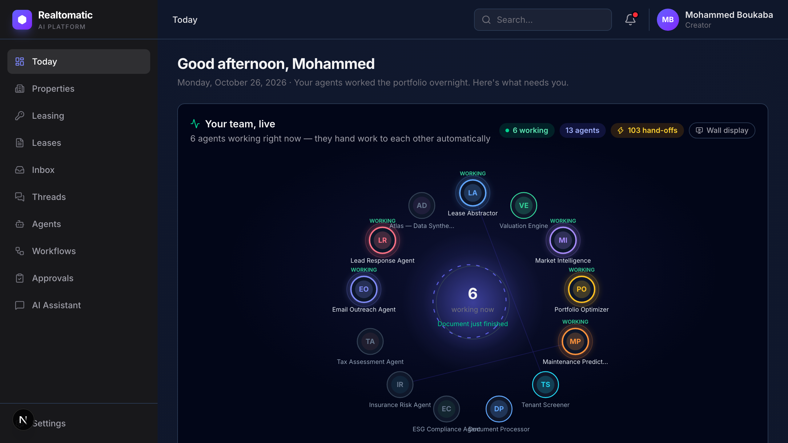
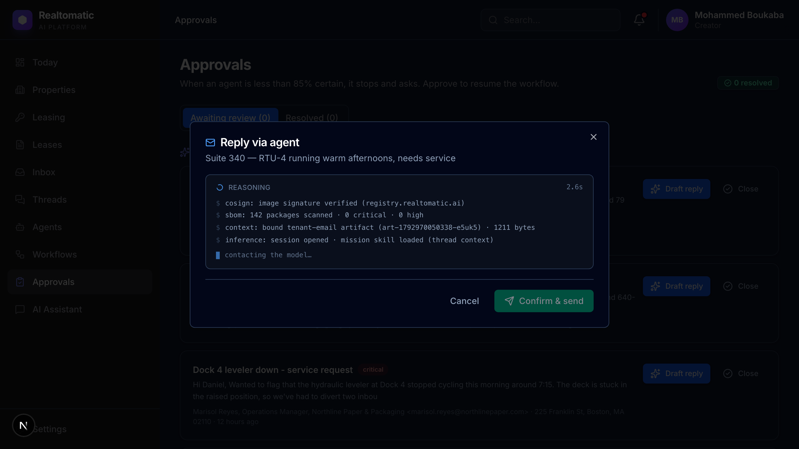

<p align="center">
  
</p>

# Realtomatic

**AI agents that run real estate operations for property managers, from lease abstraction to tenant replies and human-approved decisions.**

Designed for the US real estate market, adaptable to Europe and Asia.

`Working web app` · `Next.js 16` · `React 19` · `TypeScript` · `OpenCode` · `SQLite`

Built for **Thirduni Cohort 1, October 2026**.



*The operator view: live agent status, the work queue, and the human approval surface. The data is a synthetic demo portfolio; the agents and approvals are real.*

---

## What it is

Property managers run buildings on email, spreadsheets, and PDFs. A single day brings leaks, lease questions, expiring renewals, inbound leads, and compliance checks, each with a deadline. Existing tools add another dashboard. They do not do the work.

Realtomatic is a working web platform where a team of specialist AI agents handles that queue. Agents read leases, screen tenants, value assets, predict maintenance failures, and answer inbound tenants and leads. They consult each other when a task crosses roles. Every hand-off, result, and human decision is written to a readable thread.

The promise is narrow and deliberate: **the agents do the work. The human keeps the authority.** Anything that falls below the confidence threshold, or trips a review condition, stops at a human gate with the context attached.

## What to try first

1. Open **Today** and watch the agent constellation. Agents glow while working; the lines are recorded consults.
2. Open **Inbox**, choose an inbound tenant message, and click **Reply via agent**. The agent drafts in front of you. Edit or ask for a change, then confirm. Nothing is sent before you confirm.
3. Open **Workflows**, launch **Lease Intake & Risk Review**, and watch the steps run. When a step falls below the threshold, the workflow pauses and appears in **Approvals**.
4. Approve or reject the paused step, then open **Threads** to read the full decision trail: which agent did what, which specialist it consulted, and what the human decided.

The demo is seeded with a synthetic portfolio, so the queue is populated from the first minute.

## The core feature: a gate that actually gates

This is the feature to judge.

- A workflow step reports confidence. The orchestrator compares it to a fixed **0.85 auto-proceed threshold**. The model does not decide whether a human is needed.
- At or below the threshold, the workflow parks in `pending_approval`. It does not poll, fake progress, or continue silently.
- The operator sees the structured output, confidence, and the step context. They can approve, ask for changes, or reject.
- The decision is written into the same SQLite thread as the agent's work. Approving resumes the workflow at the paused step. Rejecting stops it and records why.
- Low-confidence or unusual items in the inbox follow the same review-before-commit pattern: the Email Outreach or chosen agent drafts the work, the operator reviews it, and nothing is sent until they confirm.

The audit trail is durable. JSON state holds the live workspace; SQLite holds the threads, messages, agent hand-offs, results, and human decisions. A restart does not erase the decision trail.



*An agent drafts a tenant reply in the approval dialog. The operator can ask for a change, confirm, or close it. Nothing is committed before the operator confirms.*

## The agent team

| Agent | What it does |
| --- | --- |
| **Lease Abstractor** | Extracts terms, clauses, dates, and non-standard language from leases |
| **Tenant Screener** | Assesses tenant risk, credit signals, guarantees, and lease exposure |
| **Valuation Engine** | Produces income and sales-comparison valuations with ranges and assumptions |
| **Market Intelligence** | Tracks vacancy, rent growth, absorption, cap rates, and submarket drivers |
| **Portfolio Optimizer** | Recommends hold, acquire, dispose, refinance, and reposition actions |
| **Maintenance Predictor** | Predicts building-system failures, time horizons, and repair cost |
| **Document Processor** | Classifies intake documents and routes them to the right specialist |
| **ESG Compliance Agent** | Assesses energy use, emissions, ordinance exposure, and upgrade paths |
| **Insurance Risk Agent** | Sizes peril exposure, coverage structure, and premium expectations |
| **Tax Assessment Agent** | Compares assessed value to market evidence and estimates appeal outcomes |
| **Email Outreach Agent** | Drafts tenant and broker email; never sends without operator confirmation |
| **Lead Response Agent** | Scores inbound leads and drafts the first reply |
| **Atlas** | Background data-synthesis agent that keeps the demo data fabric alive |

Agents do not call each other directly. The executor records a consult when a specialist is needed, and the exchange lands in the work item's thread.

## Run it locally

**Prerequisites:** Node 22+, npm, and either the [OpenCode CLI](https://opencode.ai) or an OpenAI-compatible model endpoint.

No database server, account, or cloud service is required.

### Option A: OpenCode runtime

```bash
npm install
npm run dev
```

Open <http://localhost:3000>. The home page redirects to `/dashboard`.

The first request starts the background loops: Atlas synthesizes the initial data fabric, the autopilot dispatches agent tasks, and workflows begin. State is written to `.realtomatic-state/` as JSON plus SQLite.

Useful variants:

```bash
npm run dev:go    # OpenCode Go / DeepSeek V4.1 Flash
npm run dev:free  # OpenCode Zen free tier
```

### Option B: Direct OpenAI-compatible endpoint

Any endpoint implementing `POST {baseUrl}/chat/completions` works: OpenAI, OpenRouter, LiteLLM, vLLM, Ollama, LM Studio, or a compatible gateway.

Create `.env.local`:

```bash
REALTOMATIC_LLM_BACKEND=openai
REALTOMATIC_OPENAI_BASE_URL=https://api.openai.com/v1
REALTOMATIC_OPENAI_API_KEY=sk-your-key
REALTOMATIC_OPENAI_MODEL=gpt-4o-mini
```

Then:

```bash
npm run dev:openai
```

`OPENAI_BASE_URL`, `OPENAI_API_KEY`, and `OPENAI_MODEL` are accepted as fallbacks. For a local endpoint without a key, omit the key and set the base URL.

### Option C: production build

```bash
npm run build
npm start
```

The app requires a Node host with a writable directory for `.realtomatic-state/`. It is not a static export. If the host sleeps or loses its disk, the demo state is lost.

For a public demo, use a small Node host with a persistent disk and either the OpenCode runtime or a direct OpenAI-compatible endpoint. A static host is not sufficient.

### What you should see

The dashboard opens populated with a synthetic portfolio. Within the first minute, agent cards change status, new items appear in **Needs you**, and **Your agents handled** fills with completed work. If the queue is empty, wait for the first Atlas cycle or use **Settings → Demo Controls → Reset demo state**.

### Resetting the demo

Use **Settings → Demo Controls → Reset demo state**, or:

```bash
curl -X POST http://localhost:3000/api/demo/reset
```

The reset clears artifacts, executions, workflows, approvals, and activity, then Atlas rebuilds a fresh portfolio.

## Configure it

All settings are environment variables. `.env.example` documents the full list.

| Variable | Default | What it does |
| --- | --- | --- |
| `REALTOMATIC_LLM_BACKEND` | `opencode` | `opencode` or `openai` |
| `OPENCODE_PROVIDER_ID` | `opencode-go` | OpenCode provider |
| `REALTOMATIC_MODEL` | `deepseek-v4.1-flash` | OpenCode model id |
| `OPENCODE_SERVER_URL` | auto | Connect to an existing OpenCode server |
| `REALTOMATIC_OPENAI_BASE_URL` | `https://api.openai.com/v1` | OpenAI-compatible base |
| `REALTOMATIC_OPENAI_API_KEY` | unset | Key for that endpoint |
| `REALTOMATIC_OPENAI_MODEL` | `gpt-4o-mini` | Model id, comma-separated fallbacks allowed |
| `REALTOMATIC_OPENAI_MAX_TOKENS` | unset | Hard cap per completion |
| `REALTOMATIC_OPENAI_TIMEOUT_MS` | `150000` | Per-call timeout |

The backend switch applies to every agent task, Atlas cycle, workflow step, and chat turn. `GET /api/chat` reports the active backend and model.

## Verify it works

```bash
# Is the model backend reachable?
curl -s http://localhost:3000/api/chat | python3 -m json.tool

# Does the roster load, and which backend is active?
curl -s http://localhost:3000/api/agents | python3 -m json.tool | head -30

# Are threads and decisions being recorded?
curl -s http://localhost:3000/api/threads | python3 -m json.tool | head -30

# Does the production build pass?
npm run build
```

There is no automated test suite yet. The verification above checks the working path; the [Known gaps](#known-gaps) section is explicit about what is not covered.

## What is real, and what is simulated

**Real:** the web application, the agent orchestration, live model inference, streamed reasoning, agent-to-agent consults, human approval gates, workflow pause/resume, and the SQLite thread audit trail.

**Simulated:** the property, lease, tenant, and lead catalog. Atlas synthesizes market snapshots, lease documents, tenant emails, and inbound leads with a live model. There is no PMS, MLS, email, or accounting integration, and no real tenant data.

**Not production-ready:** the public demo has no authentication, tenant isolation, rate limiting, or billing. It is a working product demonstration, not a production deployment. Every number on the dashboard belongs to the demo portfolio.

## Architecture

```
Layer 4  Next.js operator UI           dashboard, inbox, threads, approvals
Layer 3  Orchestration                 workflows, executor, autopilot
Layer 2  Specialist agents             missions, JSON contracts, consults
Layer 1  Model runtime                 OpenCode sessions / OpenAI-compatible HTTP
Layer 0  Durable state                 JSON workspace + SQLite threads
```

| Area | Files |
| --- | --- |
| Backend switch | `src/lib/llm.ts` |
| OpenCode runtime | `src/lib/opencode.ts` |
| Direct OpenAI-compatible runtime | `src/lib/direct-llm.ts` |
| Agent missions and output contracts | `src/lib/missions.ts` |
| Single agent execution | `src/lib/executor.ts` |
| Atlas data synthesis | `src/lib/fabricator.ts` |
| Autonomous dispatcher | `src/lib/autopilot.ts` |
| Workflow orchestration and human gates | `src/lib/workflow-orchestrator.ts` |
| Durable workspace (JSON) | `src/lib/store.ts` |
| Threads and audit trail (SQLite) | `src/lib/db.ts` |
| SSE plumbing | `src/lib/bus.ts`, `src/lib/sse.ts` |

Operator pages: Today, Properties, Leasing, Leases, Inbox, Threads, Agents, Workflows, Approvals, and AI Assistant.

## Why custom orchestration

Realtomatic does not use LangChain or LangGraph. The workflow layer is custom TypeScript in `src/lib/workflow-orchestrator.ts`, with execution in `src/lib/executor.ts` and dispatch in `src/lib/autopilot.ts`.

This is deliberate. The product needs a small number of fixed, auditable pipelines: ingest a lease or market artifact, triage it, abstract it, assess risk, and stop at a human gate when confidence is low. Those steps must stay tightly coupled to the artifact store, confidence scores, agent-to-agent consults, SSE updates, and the SQLite thread history. A custom layer keeps that logic explicit and lets another developer read the entire workflow in one file.

The human-in-the-loop path is real, not a UI placeholder. A step that falls below the approval threshold parks the workflow in `pending_approval`. The operator decision is written to the work item's thread and resumes the same workflow from the same step. The state lives in the local store and the thread history lives in SQLite, so the decision trail survives restarts.

The trade-offs are also explicit:

- Workflows are fixed linear templates, not arbitrary graphs with loops, branches, fan-out, or subgraphs.
- Recovery is workflow-level, not node-level. A process crash marks an in-flight workflow failed; it does not replay a half-finished node.
- Retries happen at the model layer through model fallback. There is no per-step retry policy or backoff in the orchestrator.
- Parallelism is deliberately limited by the LLM queue, not scheduled as a graph of concurrent branches.
- There is no time travel, checkpoint replay, or graph tracing.

LangGraph would be the stronger choice if the product needed arbitrary graph topology, durable node-level checkpoints, large parallel fan-out, or time travel. LangChain would help if the product needed a broad library of tool and retriever integrations. Neither is required for the current workflows, and adding a framework would hide the small amount of orchestration the product actually uses.

For this product, the custom orchestrator is the right trade-off: one working, readable path through the work, with human authority at the point that matters. If the workflow surface grows into branching, multi-tenant scheduling, or long-running recovery, LangGraph is a sensible migration target.

## Tech stack

- **Frontend:** Next.js 16, React 19, TypeScript, Tailwind CSS 4, Radix UI, Recharts, lucide-react
- **Backend:** Node.js 22, Next.js route handlers, Server-Sent Events, SQLite (`node:sqlite`)
- **AI runtime:** OpenCode SDK and OpenCode server, or any OpenAI-compatible chat-completions endpoint; DeepSeek V4.1 Flash by default
- **AI assistance:** OpenCode coding agents were used for implementation and debugging
- **State:** JSON workspace for live demo state, SQLite for durable threads and decisions

## Who built what

**Solo submission (team of one): Mohammed Boukaba.**

- Product definition, agent mission design, workflow orchestration, human-approval flow, frontend, LLM runtime integration, and demo production: Mohammed Boukaba.
- A coding assistant was used for implementation and debugging. Design decisions, product behaviour, and verification are mine; I can walk through every module and trade-off.
- No other team members.
- Project origin: the product code in this repository was developed for the Thirduni Cohort 1 submission. The repository begins from a Create Next App scaffold; no earlier product code was reused.

Built for **Thirduni Cohort 1, October 2026**.

## Demo and submission

A **3:28 walkthrough** and an **8-slide pitch deck** are submitted with the project. The walkthrough shows the working product, the agent team, the human gate, and the audit trail. The hosted demo URL is on the Thirduni submission page.

The local steps above reproduce the same product. The demo runs against a synthetic portfolio; no client data is used.

## Troubleshooting

| Symptom | Cause |
| --- | --- |
| `/api/chat` returns 503 | No model backend. Install and authenticate the OpenCode CLI, or set the direct OpenAI-compatible variables and set `REALTOMATIC_LLM_BACKEND=openai`. |
| Dashboard is empty | The first seed cycle has not finished, or the state was reset. Wait one cycle or reset the demo again. |
| `npm start` fails or serves a stale build | Run `npm run build` first. `npm start` does not build. |
| Port 3000 is busy | Another dev server is still running. Stop it or run `next dev -p 3001`. |
| A workflow is stuck in `pending_approval` | It is waiting for a human. Open **Approvals** or the matching **Thread** and decide. |
| State looks inconsistent after a restart | The JSON workspace is live state and the SQLite threads are durable. Reset the demo if needed; threads are the audit trail and are preserved. |
| Data does not change | The autopilot and Atlas loops start on the first request. Open the dashboard and wait; check the server log for runtime errors. |

## What happens next

Over the next three months I would add insurance, tax, ESG, and capital-markets agents, then connect them into one property operations graph so a single event, such as a lease expiry or a failing HVAC unit, can move across agents without a human re-entering context. I would harden the audit trail and approval gates, add portfolio reporting, and localize document and compliance models for the US first, then Europe and Asia. The goal is a system that runs the repetitive work of a property portfolio and leaves people to make the consequential calls.

## Known gaps

- The property, lease, tenant, and lead catalog is synthetic. There is no PMS, MLS, email, or accounting integration yet.
- The public demo has no authentication, tenant isolation, rate limiting, or billing.
- The orchestrator is intentionally linear; it does not support arbitrary branching, parallel graph fan-out, or node-level recovery.
- There is no automated test suite yet.
- The demo needs a writable disk and a running model backend. A static host is not sufficient.

## Repository hygiene

`.env.local` is ignored and is the only place for credentials. `.env.example` documents both backends with placeholders only. Runtime state in `.realtomatic-state/` is generated locally and ignored. No secrets, client data, or private credentials are committed.

## Licence and copyright

© 2026 Mohammed Boukaba. All rights reserved.

The repository is public so judges and reviewers can read the code, verify authorship, and run the project for evaluation. It is not licensed for commercial reuse, redistribution, or model training without written permission. See [`LICENSE`](./LICENSE).

Third-party libraries keep their own licences. See `package.json` and `package-lock.json`.

Contact: [mohammed@pullrun.dev](mailto:mohammed@pullrun.dev)
